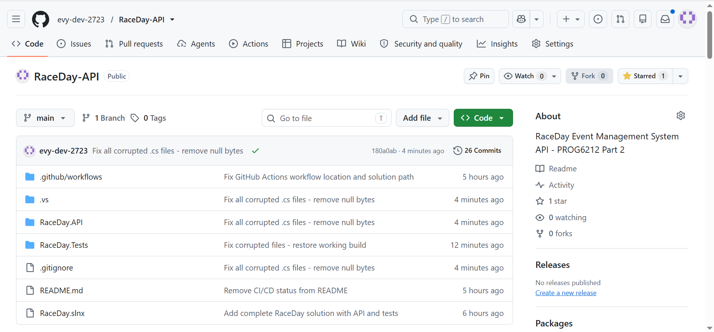

# RaceDay Event Management System

## Project Description

RaceDay is a web-based event management system for South African road running, walking and cycling events. This project is divided into two parts: Part 2 (RESTful API) and Part 3 (MVC Web Application & Docker).

## User Roles

### Organiser
- Create, edit and delete events
- Manage event categories
- View all event enrolments
- Capture participant results

### Participant
- Create account and log in
- Browse available events
- Enter an event and select a category
- View their own enrolments
- Track their own race results

---

# PART 2: RESTful API

## Project Description (Part 2)
This is the RESTful API built in C# using ASP.NET Core Web API. It connects to a SQL Server database using Entity Framework Core (Code-First) and includes JWT authentication with role-based access.

## Technology Stack (Part 2)
- **Framework:** ASP.NET Core 8.0 Web API
- **Database:** SQL Server with Entity Framework Core (Code-First)
- **Authentication:** JWT (JSON Web Tokens)
- **Password Hashing:** BCrypt
- **API Documentation:** Swagger
- **Testing:** xUnit
- **CI/CD:** GitHub Actions

## Setup Instructions

### Prerequisites
- Visual Studio 2022
- .NET 8.0 SDK
- SQL Server (localhost)

### Steps to Run

1. Clone the repository:
git clone https://github.com/evy-dev-2723/RaceDay-API.git

text

2. Navigate to the project folder:
cd RaceDay.API

text

3. Restore packages:
dotnet restore

text

4. Update the database:
dotnet ef database update

text

5. Run the API:
$env:ASPNETCORE_ENVIRONMENT="Development"; dotnet run

text

6. Open Swagger in your browser:
http://127.0.0.1:5555/swagger/index.html

text

## API Endpoints

| Resource | Endpoints | Description |
|----------|-----------|-------------|
| Authentication | POST /api/auth/register, POST /api/auth/login | Register and login |
| Users | GET /api/users/profile | View profile |
| Events | GET, POST, PUT, DELETE /api/events | Event management |
| Categories | GET, POST, PUT, DELETE /api/categories | Category management |
| Enrolments | GET, POST, DELETE /api/enrolments | Event enrolments |
| Results | GET, POST, PUT /api/results | Race results |

## Authentication

The API uses JWT tokens. To authenticate:

1. Register or login via the auth endpoints
2. Copy the token from the response
3. In Swagger, click "Authorize" and paste the token
4. Now you can access protected endpoints

## Role-Based Access

- **Organiser** can: create/edit/delete events, manage categories, capture results
- **Participant** can: view events, enrol in events, view own results

## Database Schema

The database matches the Part 1 ERD with 8 tables:
1. Roles
2. Users
3. Events
4. Categories
5. EventCategories
6. Enrolments
7. Results
8. WeatherInfo

## Running Tests

To run the unit tests:
dotnet test

text

## CI/CD Build Status

The GitHub Actions workflow builds the project and runs all unit tests on every push.

## Part 2 Video Presentation

Watch my Part 2 walkthrough here: [YouTube Link Part 2](https://youtu.be/fuYd4_nSTl8?is=v3HL8veHJ4GCJqKF)

---

# PART 3: MVC Web Application & Docker

## Project Description (Part 3)
This is the frontend MVC application that consumes the Part 2 API. It provides a clean, role-aware interface for Organisers and Participants. The application uses session-based authentication to store the JWT token and is fully containerised using Docker.

## Technology Stack (Part 3)
- **Framework:** ASP.NET Core 8.0 MVC
- **Communication:** HttpClient (consumes the Part 2 API)
- **Authentication:** Session Management (stores JWT Token)
- **Styling:** Bootstrap
- **Containerisation:** Docker

## MVC Setup Instructions
To run the full application locally:
1. Start the API in PowerShell (Terminal 1):
cd RaceDay.API
$env:ASPNETCORE_ENVIRONMENT="Development"; dotnet run

text

2. Start the MVC App in Visual Studio (or Terminal 2):
cd RaceDay.MVC
dotnet run

text

3. Open your browser and navigate to:
http://localhost:5000/Account/Login

text

## Docker Setup Instructions
Following the provided Docker guide, the MVC application is containerised using a multi-stage Dockerfile.

To build the Docker image:
cd RaceDay.MVC
docker build -t raceday-mvc .

text

To run the container:
docker run -d -p 8080:8080 --name raceday-mvc-container raceday-mvc

text

## MVC Architecture
- **AccountController:** Handles Login and Logout. Communicates with `/api/auth/login` to retrieve the JWT token and stores it in the Session. Redirects users based on their role (Organiser or Participant).
- **OrganiserController:** Handles the creation and viewing of events. Protected by session checks to ensure only Organisers can access it.
- **ParticipantController:** Allows participants to browse events and enrol.
- **Views:** Built using Bootstrap for a responsive and sporty look.

## Part 3 Video Presentation

Watch my Part 3 walkthrough here: [YouTube Link Part 3](https://youtu.be/nQoIKCW_8a8?is=0WgLN_e6moP5TnZL)

---

## Author
Evelyne Clementine Filloi - ST10492340
PROG6212 - Programming 2B
The Independent Institute of Education

## Date
November 2026
